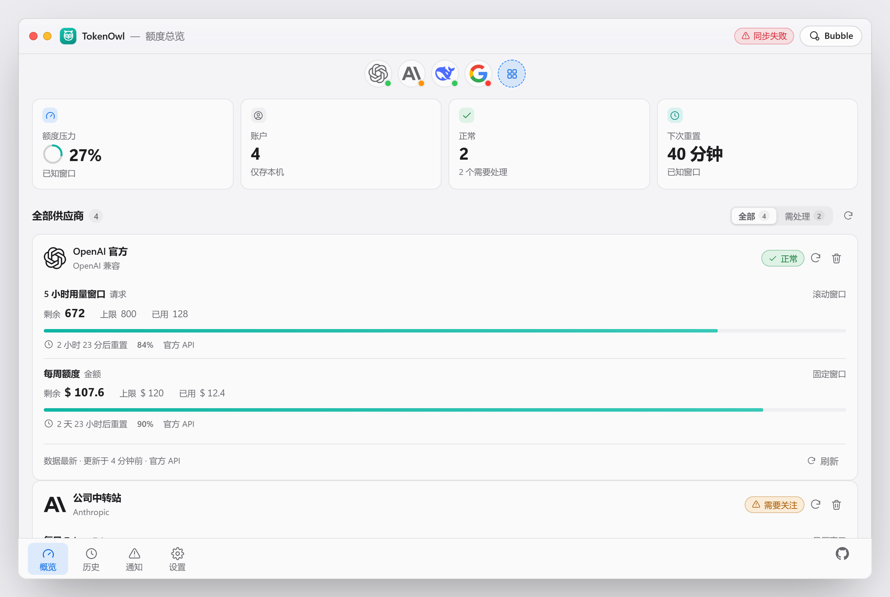
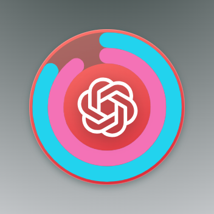
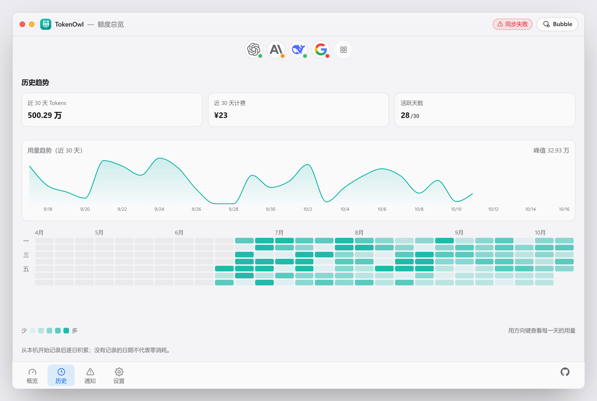

<p align="center">
  
</p>

<h1 align="center">TokenOwl</h1>

<p align="center">
  <strong>Your AI credits, at a glance — from the desktop, never from the cloud.</strong><br/>
  A local-first quota, usage &amp; balance monitor for every AI provider you rely on.
</p>

<p align="center">
  <a href="#features">Features</a> ·
  <a href="#supported-providers">Providers</a> ·
  <a href="#installation">Install</a> ·
  <a href="#how-it-works">Architecture</a> ·
  <a href="#development">Develop</a> ·
  <a href="#security">Security</a>
</p>

<p align="center">
  <a href="https://github.com/Aswellle/TokenOwl/actions/workflows/ci-rust.yml"></a>
  <a href="https://github.com/Aswellle/TokenOwl/actions/workflows/ci-frontend.yml"></a>
  <a href="https://github.com/Aswellle/TokenOwl/releases"></a>
  <a href="LICENSE"></a>
  
</p>

<p align="center">
  <a href="README.zh-CN.md">简体中文</a> · <strong>English</strong>
</p>

---

You juggle API keys across OpenAI, Anthropic, Gemini, DeepSeek, a self-hosted LiteLLM gateway, and that one Chinese provider with the credits system you never remember to check. Then a generation dies mid-stream with `429`.

TokenOwl is a small desktop companion that answers one question **before** it becomes a surprise: *how much do I have left, and when does it come back?*

It lives in a corner of your screen as a tiny always-on-top bubble, opens into a full dashboard on click, and does all of this **entirely on your machine** — your API keys go into the OS keychain, your data into a local SQLite file, and nothing ever phones home.

<p align="center">
  
</p>

## Why not just check the web dashboards?

| | Provider web consoles | TokenOwl |
| :--- | :--- | :--- |
| Check one provider | Open site, log in, navigate | Glance at the bubble |
| Check five providers | Five tabs, five logins | One dashboard |
| Mid-work low-quota warning | You find out on the next `429` | Notification *before* it hits |
| Usage over time | Per-provider, per-console | One heatmap across all accounts |
| Where your keys live | Browser sessions | OS keychain, never on disk |
| Where your usage data lives | Their servers | Your SQLite file |

## Features

**Unified monitoring** — Connect accounts from different providers and see remaining quota, usage, balance, and reset times in one normalized view. Token counts, dollar amounts, request counts, credits — each shown in its native unit, never converted into made-up numbers.

**Honest unknowns** — If a provider doesn't report a limit, TokenOwl shows *unknown*, not `0 / 100`. Every value carries its data source and freshness (`fresh` / `stale` / `expired`), so a stale reading never masquerades as a live one.

**Floating bubble** — An Apple-Watch-style double ring, always on top and draggable, with edge snapping. Outer ring maps your shortest reset window (e.g. 5-hour), inner ring the long one (e.g. weekly); the provider's brand icon sits in the center. Click it to open the dashboard.

<p align="center">
  
  &nbsp;&nbsp;
  
</p>

**Notifications that respect thresholds** — Low-quota warnings (default 20%, escalating at 10%), balance floors, reset reminders, auth-expiry alerts, and repeated network-failure detection — each deduplicated so you're never spammed.

**Usage analytics** — A 26-week GitHub-style heatmap of daily tokens and spend, a 30-day trend chart, per-provider breakdowns with 2h / 24h / 30d windows, and burn-rate projection that estimates when your quota runs out.

<p align="center">
  
</p>

**Gateway-friendly** — Self-hosting New API, One API, or LiteLLM? They're first-class built-ins with editable base URLs. Custom OpenAI-compatible endpoints work too.

**Auto-updates** — Release artifacts are signed (Minisign); the built-in updater verifies signatures before installing.

## Supported providers

29 built-in manifests across three wire protocols, graded honestly by what each provider's API actually exposes — not by what a UI would like to show:

| Level | What you get | Providers |
| :--- | :--- | :--- |
| **L4** — Full quota | quota + usage + balance + reset + identity | OpenAI, OpenRouter |
| **L3** — Usage / balance | usage or balance readable | DeepSeek, Qwen, Kimi, SiliconFlow |
| **L2** — Health / models | connection health, models, rate-limit headers | Anthropic, Gemini, Groq, Mistral, xAI, Zhipu, Doubao, Baichuan, MiniMax, StepFun, 01.AI, 360, iFlytek, Baidu, Tencent, Xiaomi MiMo, Cohere… |
| **L2** — Gateways | your deployment, your URL | New API, One API, LiteLLM |
| **L1** — Custom | any OpenAI-compatible endpoint | *Custom / compatible* |

Native Anthropic and Google Gemini protocol adapters are built in (beyond their OpenAI-compatibility layers), and **community provider packs** — drop a validated YAML manifest into the `community-providers` folder to register a new provider without touching code.

> Missing a provider? Any OpenAI-compatible API works through the *Custom* path today, and a [community pack](#community-provider-packs) takes five minutes to write.

## Installation

> **Note:** Windows builds are verified end-to-end. macOS artifacts are produced by CI but not yet exercised on real hardware — treat them as early access.

### Windows (verified)

Grab the latest installer from [Releases](https://github.com/Aswellle/TokenOwl/releases):

- `TokenOwl_x.y.z_x64-setup.nsis.exe` — recommended installer
- `TokenOwl_x.y.z_x64_en-US.msi` — MSI for enterprise deployment

### macOS (CI-built, unverified on hardware)

- `TokenOwl_x.y.z_aarch64.dmg` — Apple Silicon
- `TokenOwl_x.y.z_x64.dmg` — Intel

## Quick start

1. Launch TokenOwl — the bubble docks to the nearest screen edge.
2. Click it, then **Settings → connect an account**. Pick a provider, paste an API key. Endpoints auto-fill from the built-in manifest.
3. Data arrives within seconds; the bubble rings light up.
4. Drag the bubble anywhere — it snaps to edges and remembers where you put it.

Keys go straight into Windows Credential Manager (macOS Keychain on macOS). The SQLite database stores only a *reference* to the key, never the key itself.

## How it works

A deliberately boring, layered architecture: the webview renders; Rust does everything else.

```
┌────────────────────────────────────────────────────────┐
│  Webview (React 19 + TypeScript strict + motion)       │
│  dashboard · bubble · history · notifications          │
│  — no network permission, by capability policy         │
└──────────────────────────┬─────────────────────────────┘
                           │ semantic IPC commands only
┌──────────────────────────▼─────────────────────────────┐
│  Rust core (Tauri 2)                                   │
│                                                        │
│  scheduler ──► providers ──► domain                    │
│  jitter +      adapters +    snapshots · reset math    │
│  backoff       manifests     health grades · burn rate │
│      │             │                                    │
│      ▼             ▼                                    │
│  storage         networking        credentials          │
│  SQLite WAL      timeouts ·        OS keychain only     │
│  migrations      size limits       (ref stored on disk) │
└────────────────────────────────────────────────────────┘
```

Design decisions worth knowing about:

- **The webview cannot make network requests.** The Tauri capability set grants only core, opener, process, and updater. Every HTTP call happens in Rust through one shared client with timeouts, response-size caps, and a restrictive CSP. There is no code path from a compromised webview to your API keys.
- **Manifest-driven providers.** Each built-in provider is a declarative YAML file (`providers/builtin/*.yaml`) describing its wire protocol, endpoints, and honest capability level. Adding a provider is a data problem, not a code problem — and community packs extend the same mechanism at runtime.
- **Failure isolation per metric.** One failing endpoint degrades to an error chip on that metric; sibling endpoints keep updating. A total outage keeps the last good snapshot, marks it stale, and retries on bounded exponential backoff. The UI never freezes and never silently zeroes.
- **Versioned SQLite migrations** with integrity checks, automatic pre-migration backups, and per-migration transactions.

## Development

### Prerequisites

- Node.js 22+ and pnpm 10.33.2 (`corepack enable`)
- Rust stable 1.85+ (2024 edition)
- Tauri 2 prerequisites per [platform](https://v2.tauri.app/start/prerequisites/)

```bash
git clone https://github.com/Aswellle/TokenOwl.git
cd TokenOwl
corepack enable
pnpm install                     # workspace install (root)
```

### Everyday commands (run from `apps/desktop/`)

```bash
pnpm dev                         # Vite on :1420, browser preview of the UI
pnpm tauri dev                   # full desktop app with hot reload
pnpm typecheck                   # tsc --noEmit (strict)
pnpm test                        # vitest, jsdom
pnpm exec playwright test        # e2e smoke suite
```

```bash
cd apps/desktop/src-tauri
cargo test                       # 219 unit + integration tests
cargo clippy --all-targets --all-features -- -D warnings
cargo fmt --all
```

### Project layout

```
apps/desktop/
├── src/                 # React frontend (features/, components/, lib/)
├── src-tauri/
│   └── src/
│       ├── domain/      # snapshots, reset math, health grades, history
│       ├── providers/   # adapter trait, builtin adapters, manifest engine
│       ├── scheduler/   # priority queue, jitter, exponential backoff
│       ├── storage/     # SQLite WAL, versioned migrations
│       ├── credentials/ # OS keychain wrapper (refs only on disk)
│       ├── networking/  # shared HTTP client (limits, redaction)
│       └── commands/    # Tauri IPC handlers
├── providers/builtin/   # 29 YAML provider manifests
assets/                   # screenshots used by this README
```

### Testing philosophy

Provider parsing is covered by offline deterministic fixtures — success, partial fields, malformed JSON, 401, 429 with `retry-after`, 5xx, empty bodies, and reset-window edge cases. Secret-handling has a dedicated regression suite that byte-scans SQLite files, logs, and serialized DTOs (with positive controls). UI state transitions, freshness fallbacks, and backoff caps each have their own tests.

## Community provider packs

Drop a YAML manifest into `<app data dir>/community-providers/` and restart:

```yaml
id: my-relay
version: 1
name: My Relay
auth: [api_key]
baseUrl: https://relay.example.com/v1
apiKeyHeader: Authorization
endpoints:
  models: /models
  balance: /credits
apiFormat: openai-compatible
```

The loader is deliberately strict: manifests must parse completely, speak the `openai-compatible` protocol, declare an **https** base URL with no embedded credentials, and use an id that doesn't collide with a built-in. Invalid packs are skipped and reported in Settings — never half-registered.

## Security

- **Keys in the OS keychain only** — SQLite stores a `credential_ref`; the credential type is non-serializable and its `Debug` output is `REDACTED`.
- **Network-confined webview** — no network permission, restrictive CSP; all HTTP in Rust with HTTPS-first URL validation, size caps, and sensitive-header redaction.
- **Secret-leak regression suite** — byte-scans databases, logs, and DTOs to prove keys never reach disk in plaintext.
- **Signed updates** — Minisign-verified updater artifacts; unsigned or re-tagged releases won't install.

Found a vulnerability? Please use [private security advisories](https://github.com/Aswellle/TokenOwl/security/advisories/new) rather than public issues — see [SECURITY.md](SECURITY.md).

## Contributing

Issues and PRs are welcome — good first issues include new provider manifests (a YAML file plus fixtures) and UI polish. See [CONTRIBUTING](CONTRIBUTING.md) for the workflow, the [capability matrix](providers/builtin/) for what each provider grade means, and the in-code Rustdoc for architecture details.

## License

[MIT](LICENSE) © 2026 TokenOwl contributors

---

<p align="center">
  <sub>Built with <a href="https://v2.tauri.app/">Tauri 2</a> · <a href="https://react.dev">React 19</a> · <a href="https://www.rust-lang.org">Rust</a> — no cloud, no telemetry, no accounts.</sub>
</p>
